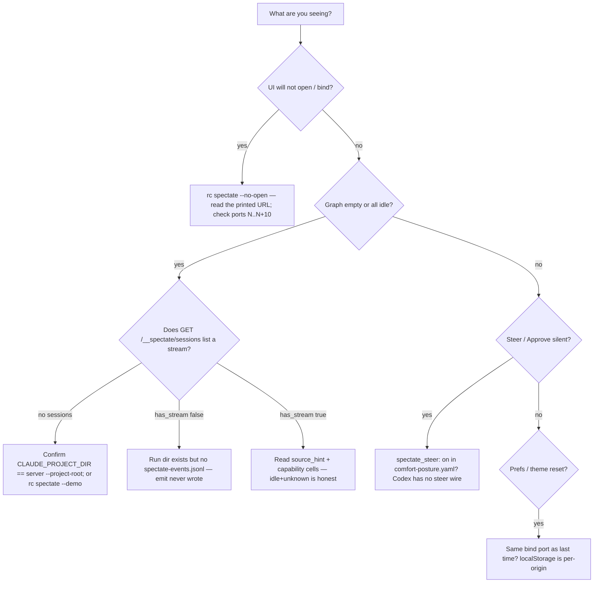

# Diagnose Harness Spectate — blank UI, idle graph, unknown cells, and silent steer

**Status:** **Primary diagnostic** — when `/spectate` is empty, every node is `idle`, a capability cell looks "broken," the launcher cannot bind a port, prefs vanish after a port change, or Approve/Deny/Interrupt does nothing, check this first.

**Domain:** Agent operability / observe-only livestream.

**Applies to:** Anyone running `bash plugins/ravenclaude-core/bin/rc spectate` (or the Claude Code `spectate` skill / `/spectate` command) against a project that has `ravenclaude-core` hooks. Architecture + honesty changelog: [`plugins/ravenclaude-core/knowledge/spectate.md`](../../plugins/ravenclaude-core/knowledge/spectate.md). Reducer invariant: [`plugins/ravenclaude-core/knowledge/concepts/harness-spectate.md`](../../plugins/ravenclaude-core/knowledge/concepts/harness-spectate.md).

---

## Why this exists

Spectate shipped as an observe-only livestream (v0.1) and grew through **v0.13** in PRs #1331 / #1333 / #1334 / #1335 / #1336 (2026-10-09–10). The knowledge file records *what each version wired*. The skill records *open the URL and arm the Claude-only push mirror*. Neither is a "this blank screen means X — do Y" rule. Mixing the surfaces up is how a session:

| Wrong move | What the code does instead |
|---|---|
| Treat an all-`idle` graph as "this harness cannot do that step" | `seed_status` maps capability `unknown` → `idle` (plus `capability_state: unknown`) and zero events → `idle`. Only a measured `unsupported` cell becomes `unavailable-harness`. This-session probe: `unknown,0` → `('idle', 'unknown')`; `unsupported,0` → `('unavailable-harness', None)`. Gate 294. |
| Open a static `dashboard.html` and expect live sessions | `/__spectate/*` is served by `serve-dashboards.py` only. `rc spectate` attaches to that server (or starts one). |
| Start `rc spectate` in repo A and emit from a session whose `CLAUDE_PROJECT_DIR` is repo B | `spectate-emit.sh` returns 0 unless `CLAUDE_PROJECT_DIR` is a directory, and writes `.ravenclaude/runs/<session>/spectate-events.jsonl` **there**. The UI lists sessions under the server's `--project-root` (the launcher's `$PWD`). |
| Treat a missing `tool_use_id` as a broken join | Gemini's BeforeTool/AfterTool docs publish no per-tool id (`tool_use_id` capability `unsupported`). Cursor `afterFileEdit` / `beforeShellExecution` omit it — the adapter never mints one from `generation_id`. |
| Click Interrupt / Approve without `spectate_steer: on` | `POST /__spectate/steer` returns **403** `spectate_steer_off`. Absent posture line ⇒ off (this-session: `spectate_steer_enabled(empty)` → `False`). Codex never wires `spectate-steer.sh`. |
| Blame `unknown` grok-bot / grok-build event cells | Capability cells stay `unknown` until a measured probe. Empty / missing streams reduce to `idle` with cause-not-established — never to `unavailable-harness`. |
| Change `--port` and expect theme/layout to follow | Prefs live in `localStorage` under `rc.spectate.v1.*`. That store is per-origin, so `127.0.0.1:8000` ≠ `:8001`. |

The UI's only write is opt-in steer (`POST /__spectate/steer`). Emit always exits **0** and prints nothing — a silent hook is not proof a line was appended.

---

## How to apply



### The three surfaces (same store, different writes)

| Surface | Reads | Writes | Use when |
|---|---|---|---|
| `rc spectate` | attach-don't-kill on `GET /__spectate/capabilities` across `--port`..`+10` | starts `serve-dashboards.py --no-reclaim --no-open` if none live; `--demo` writes synthetic runs | Any host with `python3` |
| Claude Code `spectate` skill | same launcher | also arms `spectate-push-mirror` (`monitors/watch-spectate.sh`) for the rest of the session | Claude Code only — monitors do not load elsewhere |
| `/spectate` in an already-running dashboard | poll `GET /__spectate/sessions` (5 s) + `GET /__spectate/nodes` (2 s); prefers SSE `/__spectate/stream` | `POST /__spectate/steer` only when posture is on | Browser already on loopback |

```bash
# Host-agnostic open (prints the URL; opens a browser unless Codespace / non-TTY / --no-open)
bash plugins/ravenclaude-core/bin/rc spectate
bash plugins/ravenclaude-core/bin/rc spectate --demo
bash plugins/ravenclaude-core/bin/rc spectate --no-open --port 8000
bash plugins/ravenclaude-core/bin/rc spectate --session <id>

# Prove the server, not the tab
curl -fsS -H "Host: 127.0.0.1:8000" http://127.0.0.1:8000/__spectate/capabilities
curl -fsS -H "Host: 127.0.0.1:8000" http://127.0.0.1:8000/__spectate/sessions
```

`--demo` runs `spectate_demo.py` first: eight `demo-<harness>` run dirs, each one harness, `meta.json` stamped `synthetic: true`. Re-running overwrites those three files only. `demo-copilot-vscode` is the only gallery session allowed to carry `capability_overrides` (the store ignores that key unless `synthetic: true`) so the reducer can show `unavailable-harness` — the frozen atlas has no `unsupported` cell.

Launcher bind: default `--port 8000`, walk **10** ports (`8000`–`8010`). Failure prints `could not start or find a Spectate server on ports N-(N+10)` and exits **1**. Background log: `.ravenclaude/runs/spectate-server.log` (truncated if it exceeds 2 MiB). `--foreground` execs the server in this terminal.

### Empty graph / all-idle (check this first)

1. **Project root mismatch.** Emit writes under `${CLAUDE_PROJECT_DIR}/.ravenclaude/runs/<session>/spectate-events.jsonl`. The server lists `${PWD}/.ravenclaude/runs/` from `rc spectate`. If those differ, the UI is looking at a different tree. `CLAUDE_PROJECT_DIR` unset or not a directory → emit returns 0 without writing.
2. **No stream file.** `GET /__spectate/nodes?session=…` returns **404** `no_spectate_stream` (body may include `has_hook_events: true` — hook-events exist, spectate-events do not). Session id must match `^[A-Za-z0-9][A-Za-z0-9._-]{0,127}$` or you get **400** `invalid_session_id`. A missing run dir is **404** `session_not_found`. A symlinked run dir or file is opened with `O_NOFOLLOW` and reads as absent.
3. **Honest idle.** Capability `unknown` or zero events → status `idle`. That is the reducer contract, not a defect. `source_hint` on `/__spectate/nodes` is `live` only when the last event is ≤ **60 s** old and `session.end` has not landed; otherwise `recorded` (or `demo` when `synthetic: true`).
4. **Host never wired that event.** A missing `session.end` on Gemini is a skip in `generate-gemini-hooks.py`, not a lost write. See the emit matrix below.

### Emit matrix (v0.13) — what the generators wire

`spectate-emit.sh` is observe-only: always exit **0**, empty stdout, never blocks. One scrubbed `rc.spectate.v1` line per hook event. It copies `tool_use_id` / `toolUseId` into `corr_id` when present; it never mints an id. Prompt text is not stored (`prompt_chars` only). Tool targets are a sanitized argv0 / path / origin — not the raw command.

| Host | Emit wired | Explicitly not wired |
|---|---|---|
| **claude-code** | SessionStart / End, UserPromptSubmit, Pre/PostToolUse, Stop, SubagentStart / Stop, Pre/PostCompact, PermissionRequest | — |
| **codex-cli** | Same observe set as Claude (native contract). `tool_use_id` **supported** | `spectate-steer.sh` stays unwired (`_EVENT_UNWIRED_REASON`) |
| **cursor** | SessionStart / End, UserPromptSubmit, Stop, Bash-PreToolUse, afterFileEdit, preToolUse / postToolUse, PreCompact, SubagentStart / Stop | PermissionRequest; PostCompact (no verified `postCompact` lane) |
| **copilot-cli** | SessionStart / End, SubagentStart / Stop, plus the mapped tool/stop lanes | PostCompact is a fail-safe inert projection (Chat's eight-event set omits it) |
| **gemini-cli** | SessionStart, PreToolUse, PostToolUse | UserPromptSubmit, Stop, SubagentStart / Stop, Pre/PostCompact, PermissionRequest, SessionEnd |
| **grok-build** | Harness detect via `GROK_BUILD` / `GROK_SESSION_ID` / `GROK_HOME` / `GROK_HOOK_EVENT` (deny cells `partial`) | Event-catalog cells stay `unknown` (atlas row unverified) |
| **grok-bot** | — | Atlas F06 undocumented; every cell `unknown` |

Push mirror (`watch-spectate.sh`): Claude Code only, starts on `on-skill-invoke:spectate`, not `always`. It notifies **derived labels** only (`kind` / `asserted_status` / `tool.name` / `tool.family` / `steer.action`) for `permission.*`, `steer.applied`, `tool.fail`, `session.*`, `subagent.*`, `*.truncated`. It does not echo paths, prompts, note text, or `tool.target`.

### Steer (opt-in)

```yaml
# .ravenclaude/comfort-posture.yaml — absent or any value other than exactly `on` ⇒ off
spectate_steer: on
```

| Action | What happens |
|---|---|
| Pause | Next PreToolUse is denied (`permissionDecision`) — pause-as-deny |
| Resume | Clears `paused` |
| Note | Capped at **500** chars; injected as `additionalContext` then cleared. Empty note → **400** `note_required` |
| Approve / Deny | Arms `spectate-steer.json`; PermissionRequest waits ≤ **45 s**. Timeout → empty stdout (fail-open to the host permission prompt) |
| Interrupt | Sets `interrupt_pending`; next PreToolUse / PostToolUse / UserPromptSubmit / PermissionRequest emits top-level `continue: false` + `stopReason` (`Spectate interrupt from /spectate`) |

`GET /__spectate/steer` reports `{enabled, pending}`. `POST` without posture → **403** `spectate_steer_off`. Steer is loopback (or exact Codespace Host) + the dashboard CSRF/Origin floor; no CORS.

### API / launcher errors worth naming

| Symptom | Code / message | What to do |
|---|---|---|
| Bad session query | **400** `invalid_session_id` / `invalid_query` | Check `session` / `limit` / `cursor` / `harness` |
| No run dir | **404** `session_not_found` | Wrong project root, or emit never created the dir |
| Run dir, no JSONL | **404** `no_spectate_stream` | Hooks not firing, or host skip |
| Fifth SSE client | **503** `too_many_streams` (`max: 4`) | Close a tab; heartbeat is 15 s |
| Cross-origin / non-loopback | **403** `refused: …` | Open `http://127.0.0.1:<port>/spectate`, not a LAN bind |
| Launcher cannot bind | exit **1**, ports `N`–`N+10` | Another process owns the span, or `python3` missing from PATH |
| Prefs reset | same UI, new port | Per-origin `localStorage` (`rc.spectate.v1.theme` / `density` / `layout` / `legend` / `filter` / `columns`) |

A visible Spectate tab polls `/__spectate/nodes` every **2 s** (`POLL_NODES_MS`). `serve-dashboards.py` records activity on every incoming request, so that poll is what holds off `--max-idle` (default 120 min; `0` disables). Hidden tabs stop polling (`visibilitychange`).

Sessions rank: non-synthetic **with** a stream, then non-synthetic without, then synthetic — each by mtime descending. The 5 MiB tail window and 2000-node cap are hard; a truncated view prepends `stream.truncated`.

**Do:**

- Diagnose with `GET /__spectate/sessions` then `GET /__spectate/nodes?session=…` before editing hooks.
- Match `CLAUDE_PROJECT_DIR` to the directory you launched `rc spectate` from.
- Use `--demo` to exercise the UI + reducer (gallery covers all 11 statuses) without a live harness.
- Leave capability `unknown` cells `unknown` until a dated probe exists. Gate 294 rejects an unverified upgrade.
- Turn `spectate_steer: on` only when a person is watching the tab. Codex does not consume steer.

**Don't:**

- Don't read emit's exit 0 as "a line was appended."
- Don't treat `idle` + `unknown` as `unavailable-harness`.
- Don't mint `corr_id` / `tool_use_id` from `generation_id` or a hash of the tool name.
- Don't expect Gemini SessionEnd / SubagentStop / compact / PermissionRequest events, or Cursor PermissionRequest / PostCompact.
- Don't expect the push mirror on Copilot / Codex / Cursor / Gemini.
- Don't open Spectate off loopback. The peer check is fail-closed.
- Don't commit `.ravenclaude/runs/` — it is gitignored on purpose.

---

## Edge cases / when the rule does NOT apply

- **No `python3` on PATH.** `bin/rc` prints `'rc spectate' needs python3` and exits 1 (line 171). `spectate-emit.sh` lines 32–34 and `spectate-steer.sh` line 37 return 0 before their python bodies. There is no non-Python server binary in the launcher.
- **`capability_overrides` on a real session.** Ignored. Only `meta.json` with `synthetic: true` may force an `unsupported` cell so the gallery can render `unavailable-harness`.
- **Harness mismatch on append.** `append_spectate_event` refuses a second harness on the same stream (`harness_mismatch`). One file, one harness.
- **Codespace.** Launcher skips `webbrowser` when `CODESPACE_NAME` is set and prints the URL. The server may bind `0.0.0.0`; Spectate still requires a loopback peer **or** an exact Codespace Host already on the allow-list.
- **SSE vs poll.** The UI prefers EventSource `/__spectate/stream` and falls back to the 2 s poll. Four streams is a process-wide cap, not per session.
- **Cursor `tool-pre` always allow.** The adapter emits `{"permission":"allow"}` and does not forward `tool_output` / `agent_message` / SubagentStart `task`. Bash enforcement stays on `beforeShellExecution`; formatters stay on `afterFileEdit`.
- **This is not a CI runbook.** Schema / reducer teeth live in `scripts/check-spectate.py` (Gate 294) and `scripts/check-spectate-render.mjs`. A failing gate is a fixture problem, not an operator-blank-UI problem.

---

## See also

- [`plugins/ravenclaude-core/knowledge/spectate.md`](../../plugins/ravenclaude-core/knowledge/spectate.md) — version honesty (v0.2–v0.13), surfaces, fonts, constraints
- [`plugins/ravenclaude-core/knowledge/concepts/harness-spectate.md`](../../plugins/ravenclaude-core/knowledge/concepts/harness-spectate.md) — idle + cause-not-established; unknown ≠ unavailable
- [`plugins/ravenclaude-core/knowledge/spectate-capabilities.json`](../../plugins/ravenclaude-core/knowledge/spectate-capabilities.json) — 8 harnesses × 14 keys + `tool_use_id`
- [`plugins/ravenclaude-core/skills/spectate/SKILL.md`](../../plugins/ravenclaude-core/skills/spectate/SKILL.md) — open + Claude-only push mirror
- [`hook-authoring.md`](./hook-authoring.md) — emit/steer are hooks (observe-only vs opt-in deny)
- Plan + gate: `docs/plans/2026-10-09-harness-spectate/BUILD-PLAN.md`, `scripts/check-spectate.py` (Gate 294)

---

## Provenance

Weekly docs scan (2026-10-11). Spectate v0.9–v0.13 landed 2026-10-09–10 (PRs #1331, #1333, #1334, #1335, #1336) with a knowledge file, skill, and Gate 294, but no operator diagnostic in `docs/best-practices/`. Verified this session against `plugins/ravenclaude-core/bin/rc` (`spectate` launcher), `scripts/spectate_demo.py`, `scripts/spectate_store.py` (`seed_status`, `nodes_response`, `apply_steer`, `wait_for_steer_decision`, `LIVE_WINDOW_SECONDS=60`, `MAX_SSE_STREAMS=4`, `PERMISSION_WAIT_S=45`), `scripts/serve-dashboards.py` (`_spectate_gate`, `_spectate_peer_ok`, `/__spectate/*`), `hooks/spectate-emit.sh` (`CLAUDE_PROJECT_DIR` guard, `KIND_BY_EVENT`, `corr_id`), `hooks/spectate-steer.sh` (posture grep + fail-open), `dashboard-assets/spectate/app.js` (`POLL_NODES_MS=2000`, `STORAGE_PREFIX`), `monitors/watch-spectate.sh`, and the Cursor / Gemini / Codex / Copilot hook generators' spectate skip maps. Live probes this session: `seed_status` four cases above; `spectate_steer_enabled` missing/on/off.

---

_Last reviewed: 2026-10-11_
