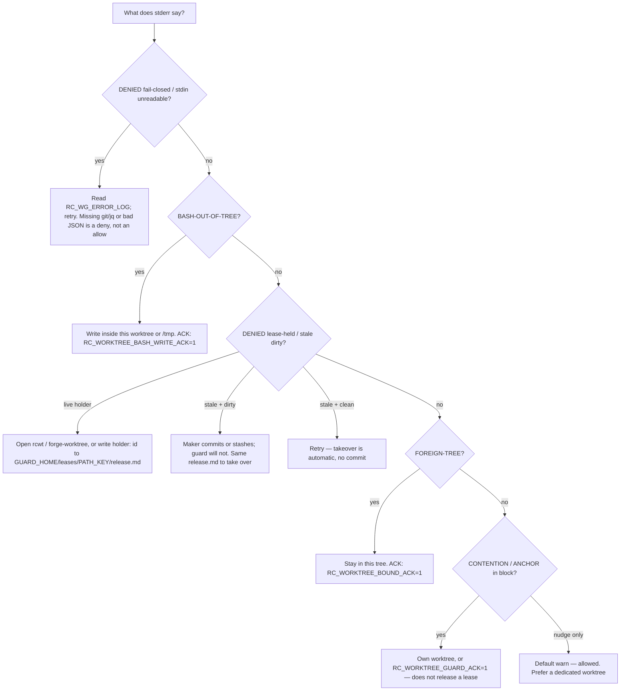

# Diagnose a worktree-guard deny — fail-closed, three knobs, and a stale lease that no longer auto-commits

**Status:** **Primary diagnostic** — when a Write / Edit / Bash is denied with `worktree-guard: DENIED`, a SessionStart LANE pin appears, or a second session cannot touch a dirty tree, check this first.

**Domain:** Agent operability / worktree isolation.

**Applies to:** Anyone running `ravenclaude-core` hooks (`worktree-guard.sh` on PreToolUse `check` and SessionStart `register`). Isolation *posture* (one worktree per peer writer) is [`plugins/ravenclaude-core/best-practices/isolate-parallel-claude-instances-in-git-worktrees.md`](../../plugins/ravenclaude-core/best-practices/isolate-parallel-claude-instances-in-git-worktrees.md). This doc is the deny-message rule.

---

## Why this exists

`worktree-guard.sh` fires on four locally-detectable conditions, each with its **own** comfort-posture knob. PR #1394 (2026-10-23) changed two operator-visible contracts: `check` **fails closed** on hook errors, and a stale lease on a **dirty** tree is recorded and denied — the guard **never** `git add` / `commit`s. Mixing the knobs, ACK env vars, or the old auto-commit story is how a session:

| Wrong move | What the code does instead |
|---|---|
| Set `RC_WORKTREE_GUARD_ACK=1` and expect a **lease** deny to clear | `GUARD_ACK` overrides CONTENTION/ANCHOR **only**. The lease clause is evaluated **before** those, and its deny names its own escapes (`release.md`, wait for stale+clean, or `worktree_lease: off`). |
| Flip `worktree_guard: off` (and even `worktree_bound: off`) to silence a second writer | The lease is a **third** independent knob, default **`on`**. ALL three must be `off` before the hook short-circuits. |
| Wait out a stale dirty lease and expect the guard to land the holder's work | AppSec 2026-10-23 deleted `_wg_lease_autocheckin`. Clean + idle → takeover (no commit). Dirty → `stale-leases.log` + **DENIED**. `git status` failure → **DENIED** (F-7), never read as clean. |
| Treat `DENIED (fail-closed)` / missing `git`/`jq` as "the guard waved this through" | On `check` with a payload, missing `git`/`jq`, malformed JSON, a crashed bash-write helper, or an unexpected exit **deny** (exit 2) and append `RC_WG_ERROR_LOG`. Empty stdin (bare CLI) still allows. |
| Treat a Bash write to `/home/…` or a sibling-unrelated path as FOREIGN-TREE | FOREIGN-TREE is **sibling worktree only**. Out-of-tree Bash (`>`, `tee`, `cp`/`mv`/`rm`, `sed -i`, inline python/node/perl) is **BASH-OUT-OF-TREE**, override `RC_WORKTREE_BASH_WRITE_ACK=1`. `/tmp` and the session worktree are allowed. |
| Write `release.md` **inside** the leased repo | The lease would deny that Write. The marker is `$GUARD_HOME/leases/<PATH_KEY>/release.md` **outside** the tree. Line: `holder: <session_id>`. |
| Read a default-`warn` contention nudge as a deny | Default `worktree_guard` is **warn** (stderr, exit 0). CONTENTION/ANCHOR deny only in **`block`**, and only a mutating op. Reads / `git status` stay allowed. |

`register` (SessionStart) **always exits 0** — it can nudge, never block.

---

## How to apply



### The three knobs (independent)

Read from `${cwd}/.ravenclaude/comfort-posture.yaml` with a `sed` idiom (no PyYAML). Absent / garbage values fall to the default. ALL-off is the only full short-circuit, and it happens **before** any git shell-out (`status` still reports).

| Knob | Default | Governs | PreToolUse deny? | ACK / escape |
|---|---|---|---|---|
| `worktree_guard` | **warn** | CONTENTION (latecomer on the same tree) and ANCHOR-WORK (primary checkout, worktrees exist, HEAD on the anchor branch) | Only in **`block`**, and only a mutating Write/Edit/Bash-git | `RC_WORKTREE_GUARD_ACK=1` |
| `worktree_bound` | **block** | FOREIGN-TREE — sibling Write / mutating `git -C` / `GIT_WORK_TREE`. Not a general jail. Sibling **Read** allowed | **`block`** (default) | `RC_WORKTREE_BOUND_ACK=1` |
| `worktree_lease` | **on** | One live claim per worktree. Idle TTL: `worktree_lease_idle_minutes` (**20**) | **`on`** (default). **`warn`** logs and proceeds | `release.md`, wait until stale **and clean**, or `worktree_lease: off` |

```yaml
# .ravenclaude/comfort-posture.yaml — defaults if the keys are absent
worktree_guard: warn                 # contention / anchor: nudge, never deny
worktree_bound: block                # sibling Write / git -C
worktree_lease: on                   # mutual exclusion; survives the other two being off
worktree_lease_idle_minutes: 20
# worktree_guard_anchor_branch: main # optional; else main-if-exists → master → main
```

```bash
# Read-only snapshot (mode, bound, live sessions, contention, siblings)
bash plugins/ravenclaude-core/hooks/worktree-guard.sh status --json
```

Registry (cross-checkout, **not** `.ravenclaude/runs/`): `${RC_WORKTREE_GUARD_HOME:-$HOME/.ravenclaude/worktree-guard}/`. Session liveness is `kill -0(pid)` **and** mtime ≤ `RC_WORKTREE_GUARD_STALE_TTL` (default **900** s) — a different clock from the lease idle minutes.

### `check` evaluation order

A deny at an earlier clause never reaches a later one.

1. **Bash out-of-tree** (`worktree-guard-bash.py`). Best-effort parse; variables / `eval` / globs can evade it. The OS write allowlist (cwd + `/tmp`) is the real backstop. Helper missing or crash → fail-closed. `/tmp`, `/var/tmp`, `TMPDIR`, and `RC_WG_EXTRA_WRITE_ROOTS` are allowed.
2. **Session lease.** Unknown age is **never** stale. A dead-pid lease on a **clean** tree is GC'd at `register`; a dirty one is left for `check` (which now denies, it does not auto-commit).
3. **FOREIGN-TREE** (`worktree_bound`).
4. **CONTENTION / ANCHOR** (`worktree_guard`). Default warn.

### Fail-closed vs fail-open (AppSec 2026-10-23)

| Situation | `check` (PreToolUse) | `register` (SessionStart) |
|---|---|---|
| Missing `git` / `jq` **and** a non-empty payload | **DENIED** fail-closed | `git` missing → exit 0 (cannot block startup) |
| Malformed / timed-out stdin | **DENIED** (`RC_GUARD_STDIN_TIMEOUT=0` restores unbounded read) | proceeds unguarded, warns |
| Empty stdin (bare CLI / tests) | **allow** (documented no-payload contract) | n/a |
| Not a git repo, or no `sha256sum`/`shasum` | **allow** | **allow** |
| Unexpected exit / lease-section `ERR` | **DENIED**, line in `RC_WG_ERROR_LOG` | cannot block |

Default error log: `${RC_WG_ERROR_LOG:-/workspace/state/worktree-guard/errors.log}`. Default stale-lease log: `${RC_WG_STALE_LOG:-/workspace/state/worktree-guard/stale-leases.log}`. Override the env vars in consumer environments that are not `/workspace`.

**Do:**

- Match the deny **prefix** (`fail-closed`, `BASH-OUT-OF-TREE`, `FOREIGN-TREE`, `stale lease`, `holds a live lease`, contention/anchor) before flipping a knob.
- Open a dedicated worktree (`rcwt` / `forge-worktree.sh` / `claude -w`) when two writers need the same repo.
- Release a lease you own by writing `holder: <your-session-id>` to `$HOME/.ravenclaude/worktree-guard/leases/<PATH_KEY>/release.md`, then retry.
- Commit or stash **your** dirty tree before another session needs it. The guard will not do that for you.

**Don't:**

- Don't set `RC_WORKTREE_GUARD_ACK=1` to beat a lease. It will not.
- Don't set `worktree_guard: off` and assume the second session can write. Check `worktree_lease`.
- Don't expect auto-commit on takeover. That path was deleted.
- Don't treat fail-closed + missing `jq` as a silent allow. That was the pre-#1394 floor on `check`.
- Don't treat a path owned by **no** worktree as FOREIGN-TREE, and don't expect the lease to jail `~/.claude/` memory files (lease enforces only inside **this** tree).
- Don't disable all three knobs on an unattended overnight posture "to be helpful."

---

## Edge cases / when the rule does NOT apply

- **A pristine single checkout with no siblings and no second session.** None of the four conditions fire. The hook is silent.
- **Reads.** `Read` / `Grep` / `git status` are never denied by contention, FOREIGN-TREE, or the lease. Gate 140 P2.
- **`worktree_lease: warn`.** Live-holder and stale-dirty become stderr + proceed; nothing is staged.
- **Copilot / Cursor PreToolUse payload.** No `transcript_path` — lease identity degrades to `pid-ttl`, visibly, not silently.
- **Bash-out-of-tree is best-effort.** A crafted `eval` can evade the parser; that is not a FOREIGN-TREE miss.
- **This is not the isolation pattern.** "Give each peer writer its own worktree" lives in the plugin best-practice linked above. This diagnostic is what to do when the hook already denied.
- **Fail-closed / lease-hardening fixtures** (`test-worktree-guard-failclosed.sh`, `test-worktree-guard-lease-hardening.sh`) exist beside Gate 140 / the core suite. This-session they passed (29/0 and 11/0). They are not the Gate 140 job in `audit-gates.sh`.

---

## See also

- [`plugins/ravenclaude-core/best-practices/isolate-parallel-claude-instances-in-git-worktrees.md`](../../plugins/ravenclaude-core/best-practices/isolate-parallel-claude-instances-in-git-worktrees.md) — one worktree per peer writer (the posture this hook enforces)
- [`comfort-posture-behavioral-flags-vs-permissions.md`](./comfort-posture-behavioral-flags-vs-permissions.md) — `worktree_*` knobs are another orthogonal surface; `allow` does not silence them
- [`hook-authoring.md`](./hook-authoring.md) — PreToolUse deny vs SessionStart-cannot-block
- [`plugins/ravenclaude-core/skills/new-worktree/SKILL.md`](../../plugins/ravenclaude-core/skills/new-worktree/SKILL.md) · [`cleanup-worktrees`](../../plugins/ravenclaude-core/skills/cleanup-worktrees/SKILL.md)
- Engine + fixtures: `plugins/ravenclaude-core/hooks/worktree-guard.sh`, `worktree-guard-bash.py`, `hooks/tests/test-worktree-guard-failclosed.sh`, `test-worktree-guard-lease-hardening.sh`, Gate 140 `test-gate140-worktree-guard.sh`

---

## Provenance

Weekly docs scan (2026-11-08). PR #1394 (2026-10-23) made `check` fail closed and deleted stale-lease auto-commit. The plugin isolation pattern and hook header already named the four conditions; operators still had to re-derive which ACK releases which clause, that `worktree_guard: off` does not drop the lease, and that a dirty stale tree is now a deny rather than a commit. Verified this session against `worktree-guard.sh` (`_wg_fail_closed`, lease clause before FOREIGN/CONTENTION, `_wg_tree_state` F-7, bash-out-of-tree before lease) and `worktree-guard-bash.py` (exit 3 = out-of-tree). Live: `test-worktree-guard-failclosed.sh` → 29 pass, 0 fail (including `stale-dirty-denied`, `stale-no-git-add-or-commit`, `stale-clean-takeover`, malformed-JSON deny); `test-worktree-guard-lease-hardening.sh` → 11 pass, 0 fail (`release.md` takeover, dirty dead-pid lease survives register GC); Gate 140 → all assertions pass (read allowed; `GUARD_ACK` overrides contention only).

---

_Last reviewed: 2026-11-08 by `docs-automation`_
