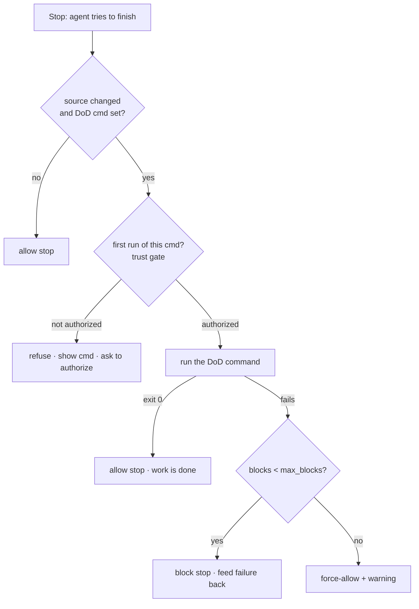
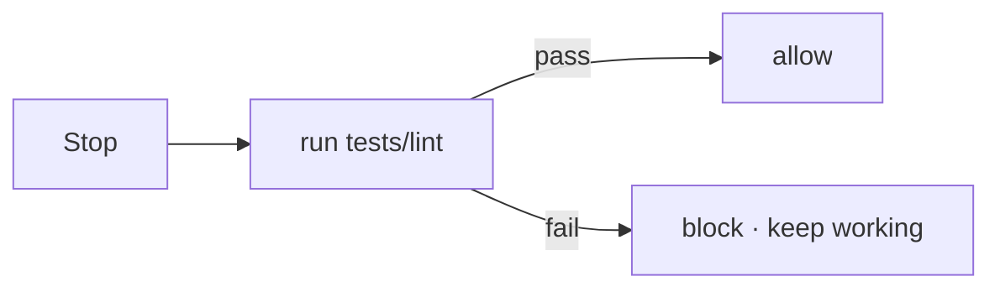

The **definition-of-done gate** closes the gap that command review can't see: it gates work **correctness**, not command safety. The Thing tribunal asks "is this command dangerous?"; this gate asks "is the work actually finished, or does it just *look* finished?" It is a `Stop` hook — it fires when the agent tries to end its turn — and if a `definition_of_done.cmd` is configured in `.ravenclaude/comfort-posture.yaml`, it runs that command (your tests, build, lint) and **blocks the stop until the command exits zero**. That turns "looks done" into "is done" without the human having to be the verification loop.

The gate is **scoped and self-limiting** so it never becomes an obstacle. It only fires when *source files actually changed* this session (it inspects `git status --porcelain` for code extensions), so a docs-only or read-only session ends cleanly. When the command fails, the gate feeds the tail of the failing output back to the agent so it can fix the problem and try again. To guarantee it can't deadlock, it blocks at most **`max_blocks`** (default 8) consecutive times, then releases the stop with `VERDICT: STOP` (end the turn; do not ask). Claude Code force-overrides Stop after 8 anyway, but Copilot CLI gives no such guarantee, so the cap is ours. On Copilot that release is a user warning, not a new prompt. The first-run trust refusal counts toward that same cap. With no `definition_of_done.cmd` set, the gate is inert and the advisory `remind-tests.sh` nudge handles the reminder instead.

Copilot turns a Stop block reason into the next user prompt, so the first line is a verdict. No block means **DONE**: end the turn and do not ask. `VERDICT: NOT DONE` means do the single `[FAIL]` line, then stop again. `VERDICT: STOP` means `max_blocks` is reached: end the turn and say the gate did not pass.

One safety detail: the configured command is shell-executed, and it comes from a YAML field a malicious pull request could edit. So before the first run per session for a given command value, the gate refuses to execute and names the literal command. **A person** creates `.ravenclaude/runs/dod-gate/<session>/confirmed-<hash>` outside the agent session. The agent must not create it. Write and Bash attempts are denied. Set `definition_of_done.trusted: true` in a later commit than the `cmd` line to skip the prompt. Rotating the command or starting a new session re-triggers the check. The diagram node "ask to authorize" means that person, not the agent. Like the other guardrails it is **opt-in and deterministic** — the verdict is a command's exit code, no model in the loop — so it ports through the adapter's `stop` mode. The trust refusal is stdout JSON (`decision: block`) at exit 0, because Copilot drops stderr when a hook exits 2.

<!-- mini -->

