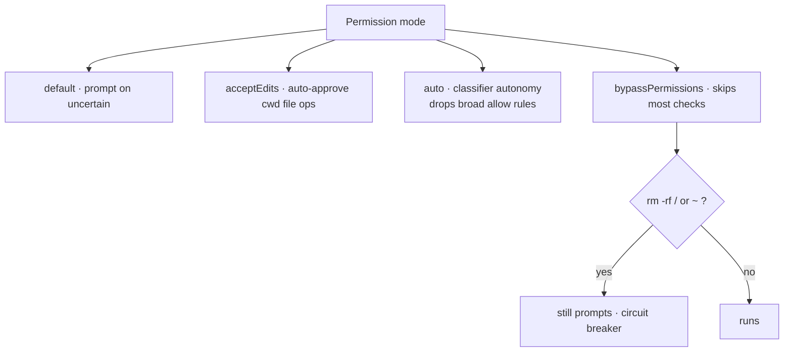
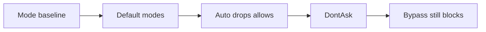
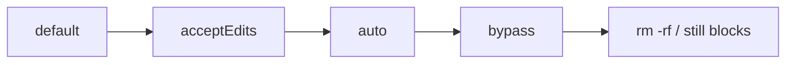

The permission **mode** sets the baseline posture on top of your allow/ask/deny rules. There are six: `default` (shown as **Manual** — asks before most edits, shell commands, and network access), `acceptEdits` (auto-approve file edits and common filesystem Bash inside the working directory), `plan` (research and propose — Claude doesn't edit your source until you approve the plan), `auto` (a classifier model reviews actions instead of you; the built-in starting mode for interactive terminal and VS Code sessions since v2.1.283), `dontAsk` (auto-deny every call that would otherwise prompt — handy for CI), and `bypassPermissions` (skips most checks).

Two surprises bite. **`bypassPermissions` is not a total kill-switch:** `rm -rf /` and `rm -rf ~` *still* prompt as a circuit breaker (in a terminal, on a two-minute countdown after which the removal is denied), and a `PreToolUse` hook `deny` still blocks. **`auto` mode silently drops broad allow rules** — `Bash(*)`, wildcarded interpreters, package-manager run commands (e.g. `npm run *`), and all `Agent` and `Monitor` allows are dropped while it's active (they restore when you leave), and `defaultMode: "auto"` is *ignored* when set in `.claude/settings.json` or `.claude/settings.local.json` (the built-in default applies instead) — put it in user-level `~/.claude/settings.json`.

<!-- step: The mode sets the baseline posture on top of your allow/ask/deny rules. -->

<!-- step: default asks first; acceptEdits auto-approves cwd file ops; plan proposes, no source edits until approved. -->

<!-- step: auto is classifier autonomy — but it silently DROPS broad allow rules like Bash star. -->

<!-- step: dontAsk auto-denies anything that would otherwise prompt (handy for CI). -->

<!-- step: bypassPermissions skips most checks — but rm -rf / still prompts and a hook deny still blocks. -->

<!-- mini -->

