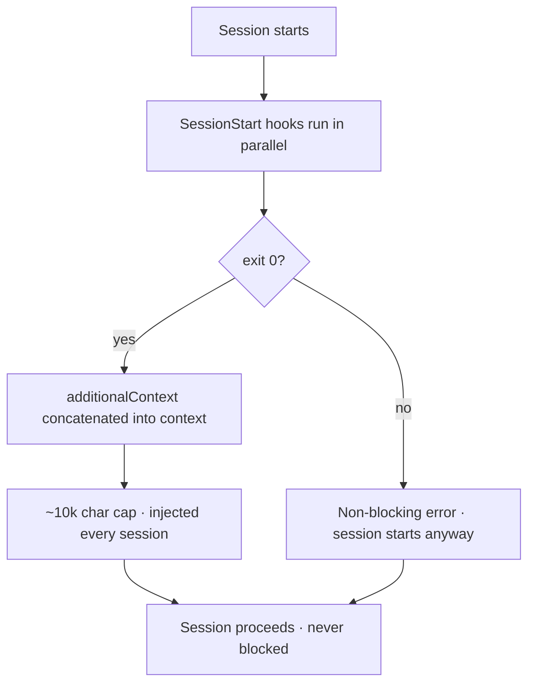
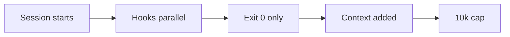
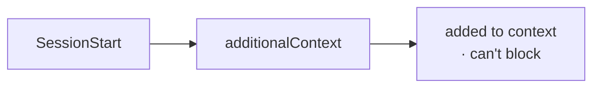

`PreToolUse` hooks gate tool calls; **`SessionStart` hooks can't gate anything.** Their job is to add text to the session via a different field — `hookSpecificOutput.additionalContext` — and nothing more. Plain-text stdout becomes context on **exit 0**; any other exit is a non-blocking error (exit 2 shows its stderr to the user only — Claude never sees it) and the session still starts. A SessionStart hook can never block a session, but it can delay the first response: the hooks run in the background so you can type at once, yet "Claude's first response still waits for the hooks to finish" and a prompt sent meanwhile doesn't reach Claude until they do — so keep them fast. Its output is purely additive.

Rules that bite: hook output strings — `additionalContext`, `systemMessage`, `initialUserMessage`, and plain stdout — are **capped at 10,000 characters**; output past the cap isn't silently cut, it's **saved to a file and replaced with a preview plus the file path** (a preview of up to the first 2,000 characters; a large valid Bash result is handled the same way). It's injected every session either way, so it's a recurring token cost — keep it tight. **multiple SessionStart hooks run in parallel and their outputs are concatenated**; the optional `matcher` is `startup` / `resume` / `clear` / `compact` / `fork`; and like other hooks it **fails open** on timeout. This is the mechanism RavenClaude's capability banner rides on.

<!-- step: A session starts; SessionStart hooks run in parallel. -->

<!-- step: They can't gate anything — plain-text stdout becomes context on exit 0. -->

<!-- step: A non-zero exit is a non-blocking error; the session starts anyway. -->

<!-- step: Each hook's additionalContext is concatenated into the session context. -->

<!-- step: Capped near 10k chars (injected every session); fails open on timeout. -->

<!-- mini -->

