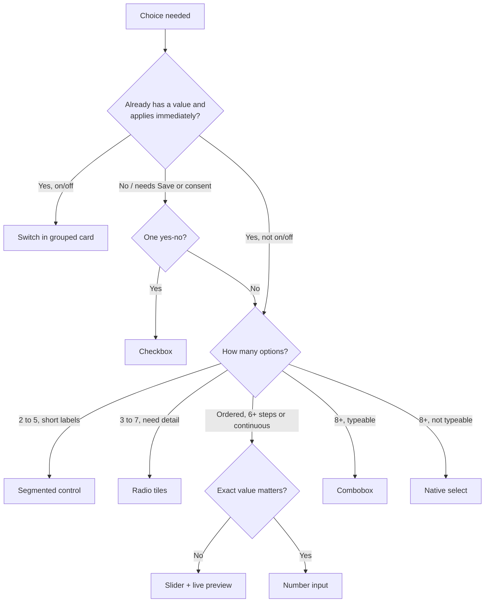

# Settings and choice controls (2026): tiles, segments, sliders, switches, short copy, sheets, usage cards

> **Retrieved:** 2026-11-05. Facts marked `[docs-verified 2026-11-05]` were read from the named primary page in
> this session (W3C WAI-ARIA APG, W3C WCAG 2.2 Understanding pages, MDN, GOV.UK Design System). `[inference]` is a
> house default no source states: a starting value you may change with a written reason. `[unverified]` was not
> fetched or could not be fetched. **No user study in this repository shows that tiles beat dropdowns or that
> shorter copy converts better.** The preference below rests on GOV.UK's own published statement about selects,
> the platform guidance quoted per control, and convention. Test it ([`ux-research`](../../ux-research/knowledge/ux-research-patterns-2026.md)
> "Testing a settings-surface redesign") before quoting it as a result.
>
> **Scope.** This is the design side: which control, how it is composed, how much text it gets. The markup,
> keyboard and screen-reader contract per control is
> [`accessibility-engineering`'s `settings-controls-markup-and-keyboard-2026-11.md`](../../accessibility-engineering/knowledge/settings-controls-markup-and-keyboard-2026-11.md).
> The component API for the primitives is in
> [`design-systems-engineering`'s reference](../../design-systems-engineering/knowledge/design-systems-reference-2026.md).
> Server-side form handling stays with [`forms-engineering`](../../forms-engineering/CLAUDE.md).
>
> **This is not the missing forms gap-fill.** The 2026-11-04 capture's forms-and-interaction run never landed
> ([`ui-pattern-standing-bar-2026-11.md`](../../ux-research/knowledge/ui-pattern-standing-bar-2026-11.md)). Nothing
> here claims to be it, nothing re-grades its rows, and no claim from that capture is reused.

## 1. Settings versus questions (decide this first)

| | **Setting** | **Question** (form field) |
|---|---|---|
| A value already exists | yes — show it | no — collecting an answer |
| Takes effect | on change (autosave) | on submit |
| Pre-selected option | **yes**, the current value | **no** — don't pre-select (see [`form-builder-2026.md`](form-builder-2026.md) single-choice row) |
| Feedback | inline "Saved" + undo where reversible | validation on submit/blur |

The rules below apply to both, but the pre-selection, autosave and switch rules differ. A control that mixes the
two (a switch inside a form that needs a Save button) is the usual defect.

## 2. The control ladder: lightest visible control that shows the choices `[docs-verified + inference]`

The principle: when the set is small and known, **show the choices instead of hiding them behind a click**.
GOV.UK says a select "should only be used as a last resort in public-facing services" because "research shows
that some users find selects very difficult to use" `[docs-verified 2026-11-05, GOV.UK Select]`. That is GOV.UK's own
research claim, not independently verified here. GOV.UK gives **no option-count threshold** for radios or selects
`[docs-verified 2026-11-05]`; the numbers below are house defaults.

| Choice shape | Control | Built from |
|---|---|---|
| On/off, applies now | **Switch** in a grouped settings card (§4) | checkbox + switch semantics |
| On/off, needs Save or is a legal/consent statement | **Checkbox**, never a switch | `<input type=checkbox>` |
| 2–5 short mutually exclusive options (mode, view, density, text-size stops) | **Segmented control** (§3) `[inference: cap 5]` | native radio group |
| 3–7 options that need a description, price, icon or badge | **Radio tiles** (choice cards) (§3) `[inference]` | native radio group, label wraps the tile |
| Money or quantity presets plus "something else" | **Amount tiles** + "Other" that reveals a number field | radios + `inputmode="decimal"` text input |
| Several of a small set | **Checkbox tiles / chips** | native checkboxes |
| Continuous or ≥6 ordered steps, exact value unimportant (text size, volume, density) | **Slider with live preview** (§5) | native `input type=range` |
| Exact number (quantity, amount) | Text input, `inputmode="numeric"`, optional stepper buttons | per [`form-builder-2026.md`](form-builder-2026.md) |
| 8+ options, known list people can type (country, timezone) | **Combobox/autocomplete**; a native `<select>` is acceptable where the mobile picker helps `[inference]` | `<select>` or combobox |
| Large multi-select | Searchable list with checkboxes | listbox/combobox |



**Do not "fix" a `<select>` by restyling it as a custom listbox.** Replace it with a visible control (above) or a
combobox, or leave the native one. A custom div-based dropdown is the scenario in
[`accessibility-engineering/scenarios`](../../accessibility-engineering/scenarios/2026-06-08-clean-scan-was-not-conformance.md).

## 3. Segmented controls, radio tiles, amount tiles

1. **They are radio groups.** One `fieldset` + `legend`, one native radio per option, arrow keys move and select,
   one tab stop `[docs-verified 2026-11-05, APG Radio Group]`. A segmented control that switches **panels** of
   content is tabs, not a segmented control: use the tabs pattern `[unverified this session]`.
2. **Labels ≤ 2 words / ~12 characters** per segment `[inference]`. A label that wraps is a tile, not a segment.
3. **Equal width, one row.** If segments don't fit at 320 px (see [`adaptive-layout`](../skills/adaptive-layout/SKILL.md)),
   switch to a stacked tile list. Don't scroll a segmented control sideways.
4. **Selected state is more than color:** fill + weight or a check/outline (house rule [`color-not-the-only-signifier`](../best-practices/color-not-the-only-signifier.md)).
5. **Hit area is the whole segment or tile**, at least 24×24 CSS px (WCAG 2.5.8, [`a11y-visible-focus-and-target-size`](../best-practices/a11y-visible-focus-and-target-size.md)); aim for 44 px high on touch `[inference]`.
6. **Tile anatomy:** title (the label) → one-line caption → optional trailing value (price, badge). No links or
   buttons *inside* a tile; the tile is the label of one input `[inference]`.
7. **Amount tiles:** 3–5 presets, the most common pre-highlighted only when it is a *setting* (§1), always an
   "Other" tile revealing one numeric field. The currency is in the group label, not only a `$` glyph (prefixes
   are not read out; see the Currency row in [`form-builder-2026.md`](form-builder-2026.md)).
8. **Single-select reveals:** reveal only *questions*, keep them simple, never under inline radios
   `[docs-verified 2026-11-05, GOV.UK Radios]`; GOV.UK also notes revealed content is not always announced.

## 4. Switches in grouped cards

1. **One card per topic.** Card heading (an `h2`) + rows. Each row: short label, optional one-line caption, switch
   on the right. The whole row is the click target through the label `[inference]`. This is the
   [`card-tile-ui`](../skills/card-tile-ui/SKILL.md) tile with rows inside it.
2. **Fixed label.** The label does not change with state ("Email alerts", not "Enable email alerts" / "Disable
   email alerts") — APG calls this critical `[docs-verified 2026-11-05, APG Switch]`.
3. **A switch means "now".** It applies on change, shows "Saved" (or an error and a rollback), and is reversible.
   Anything that needs a Save button, a confirmation, or is a legal agreement is a checkbox `[inference]`.
4. **State text for non-sighted and low-vision users:** the switch shows On/Off *text or a glyph*, not only a
   thumb position and color.
5. **Order by frequency, then risk.** Put destructive or irreversible settings in their own card, not as a
   switch in a list of harmless ones `[inference]`.
6. **Don't depend on the native `switch` attribute yet.** MDN flags `<input type=checkbox switch>` as experimental
   with limited support `[docs-verified 2026-11-05, MDN]`. Style a checkbox yourself.

## 5. Sliders with live preview (text size, density, volume)

1. **Native `input type=range`**, implicit role `slider` `[docs-verified 2026-11-05, MDN]`. Use it only when the
   exact value is unimportant; MDN: "this kind of widget is imprecise" `[docs-verified]`. Otherwise use a number
   input (§2).
2. **≤5 named stops → prefer the segmented control** with a preview; **≥6 steps or continuous → slider** `[inference]`.
   The two share one preview component.
3. **Live preview, applied on `input`, committed on `change`** `[inference]`. The preview is a real sample (the
   paragraph, the card), not a label. Tie to the existing game-UI settings row in
   [`game-ui-lessons-for-the-web-2026.md`](game-ui-lessons-for-the-web-2026.md) §3 ("Settings with live preview").
4. **Show the value** next to the control in an `<output>` with units, and set `aria-valuetext` to a human string
   ("Large, 18 px"), because APG says to use it when the number "isn't user-friendly"
   `[docs-verified 2026-11-05, APG Slider]`.
5. **Label the endpoints** ("Smaller" / "Larger") and give the stops names where they exist.
6. **A reset to default** sits beside every slider that has a default `[inference]`.
7. **Dragging needs a non-drag path.** WCAG 2.5.7 (Level AA) requires a single-pointer alternative to dragging;
   its Understanding page treats a range slider as in scope and names click/tap on the track as one alternative
   `[docs-verified 2026-11-05]`. It does **not** say whether a *native* slider falls under the user-agent exception
   `[docs-verified: silent]`. Rule: add −/+ step buttons on any text-size or other settings slider `[inference]`.
8. **Text size is not zoom.** The preview scales `rem`-based type; it never replaces browser zoom or breaks reflow
   at 200 % (WCAG 1.4.4 / 1.4.10 `[unverified this session]` — verify with the device matrix).

## 6. Short copy: label + caption + "more info"

The goal is scanning. Make the control carry the meaning and keep words for the cases that need them.

| Layer | Budget `[inference]` | Always visible? |
|---|---|---|
| Page title | ≤ 4 words | yes |
| Page lede | none, or one sentence | yes |
| Group heading | ≤ 3 words | yes |
| Control label | ≤ 4 words / ~28 characters | yes |
| Caption | ≤ 1 line (~80 characters), plain verb | yes |
| "More info" | ≤ 2 sentences + one "Learn more" link | on demand (toggletip) |

1. **A caption only restates what the label can't carry:** the consequence ("Pauses new bookings"), a unit, a
   limit. If it repeats the label, delete it.
2. **Essential information is never only in the "more info".** Cost, irreversibility, a limit, an error and
   anything needed to decide stay visible. Inclusive Components calls tooltips "a last resort, where space really
   is at a premium" and the `title` attribute "not keyboard accessible" `[docs-verified 2026-11-05, secondary
   source, single author]`.
3. **Toggletip, not tooltip, for "more info".** A real `<button>` labelled "More about <label>" reveals the
   message into a `role="status"` region. Tooltips fire on focus, which on touch happens at the moment of press
   `[docs-verified 2026-11-05, Inclusive Components]`. Tooltips remain right for naming an icon-only control or
   expanding an abbreviation. Primary navigation still needs a **visible** label
   ([`ui-pattern-standing-bar-2026-11.md`](../../ux-research/knowledge/ui-pattern-standing-bar-2026-11.md) solid rule).
4. **Hover/focus content must satisfy WCAG 1.4.13 (AA):** dismissible without moving pointer or focus, hoverable,
   persistent until dismissed `[docs-verified 2026-11-05]`. APG's own tooltip page is marked work in progress with
   no task-force consensus `[docs-verified 2026-11-05]`, so don't cite it as settled.
5. **Cut by moving, not deleting.** Long explanation moves to a docs page behind "Learn more". Removing words that
   carried a decision has cost conversion before; read
   [`forms-engineering` scenario 2026-08-17](../../forms-engineering/scenarios/2026-08-17-we-removed-fields-and-conversion-fell.md)
   (denominator, then claim) before reporting that shorter copy "worked".

**Before → after** (illustrative, not measured):

```text
Before: [Dropdown: Notification frequency ▾]   "Choose how often you would like to receive
        email notifications from us about activity in your account. You can change this at any time."
After:  Email digest    [ Instant | Daily | Weekly ]            (segmented control)
        Summary of account activity.                           ⓘ  (toggletip: "Instant sends each event…")
```

## 7. Bottom sheets and overlays (connector authorize, multi-account)

A bottom sheet is a **modal dialog** that sits at the bottom on narrow screens and as a centered dialog or side
panel on wide ones. It adds no ARIA pattern of its own `[inference]`.

1. **Build on the modal-dialog pattern:** `role="dialog"`, `aria-modal="true"`, a visible title as the name, focus
   moves in on open, Tab is contained, Esc closes, focus returns to the opener `[docs-verified 2026-11-05, APG
   Dialog (Modal)]`. This repo already prefers native `<dialog>.showModal()` over a bespoke modal
   ([`reach-for-semantic-html-before-aria`](../best-practices/reach-for-semantic-html-before-aria.md); APG's page
   does not mention the native element `[docs-verified]`).
2. **Drag handle and swipe-down are enhancements.** A visible Close button and Esc always exist (WCAG 2.5.7).
3. **One sheet deep.** A sheet never opens a sheet `[inference]`. Add account, Authorize on one account,
   and Advanced all replace this sheet's content.
4. **Sizing:** `max-height` in dynamic viewport units with the safe-area insets from
   [`adaptive-layout`](../skills/adaptive-layout/SKILL.md); content scrolls inside the sheet, the title and primary
   action stay visible `[inference]`.
5. **State in the URL when not secret** (which sheet, which provider, which step), so a reload resumes and the
   browser's Back control moves one step. From the accounts step, that Back closes the sheet. The in-sheet Back
   button does the same. Tokens, codes, labels and emails never go in the query string `[inference]`
   ([`portal-and-agent-accessibility-2026-11.md`](../../accessibility-engineering/knowledge/portal-and-agent-accessibility-2026-11.md), provisional row).

### What was checked against Grok Bot help (2026-11-05)

Two public help pages were fetched. The product UI was not opened, so a control that exists only in the app is
not something these pages can confirm or deny.

| Page | What it says `[docs-verified 2026-11-05]` |
|---|---|
| [Connect apps](https://cursor.com/help/grok-bot/connect-apps) | Connect apps is in the sidebar. Adding an app ends in **Authorize** or **Authenticate**, then the provider's own sign-in in the browser. **Gmail connects one mailbox at a time** (disconnect to switch). **Notion can connect a second account.** On the phone the sign-in action is **Authorize**; on the desktop help for that same action the word is **Authenticate**. |
| [How Tos](https://cursor.com/help/grok-bot/how-to), "How do I add a second account for the same app?" | Open the app from Connect apps. Under **Accounts**, choose **Add Another Account**, give it a label such as "work" or "personal", then **Authorize** and sign in. On the phone: **Add account**. If **Add Another Account** is missing, that app is one account at a time. The person later names the account by its label. |

Those two pages do not describe an "N accounts" count on the list row, a bottom sheet, base-scope tiles named
**Minimal / Read only / Full / Requested**, scope pills, an Advanced editor, **Required** tiles, or **Additional
Access** groups. That is absence from these pages, not a claim about the product UI.

The four surfaces below are the owner's requirement for the portal `[user-described 2026-11-05]`. Where a
help-page fact and that requirement differ, both stay. This section does not reproduce Grok Bot.

### 7a. Four surfaces, one sheet

| # | Surface | What is on it | What moves forward |
|---|---|---|---|
| 1 | **Connect-apps list** | One row per connector: the provider's **brand icon**, the provider **name**, the account count as text ("2 accounts", or "Not connected" at zero), and a status chip when an account needs attention (icon + word) | **Authorize** opens the sheet. The button's name is "Authorize \<Provider\>" |
| 2 | **Accounts sheet** | Title is the provider name plus the same brand icon. An **Accounts** list: one row per account with the person's label, the provider identifier when one exists, status as text, and granted scopes as pills. Each row has its own **Authorize**. **Add account** is last | **Authorize** on a row, or **Add account**, replaces this content with surface 3. No second sheet |
| 3 | **Choose access** — visible text "Step 1 of 2: Choose access" | On Add account, a label field comes first. Then four **base-scope tiles**: **Minimal**, **Read only**, **Full**, **Requested**. The chosen scopes are **pills**. **Advanced** edits that set | **Continue**. Disabled until one base tile is selected, with the reason in text |
| 4 | **Authorize** — visible text "Step 2 of 2: Authorize" | The account is already chosen, shown as text ("Authorize as \<label\>", or "New account" until the provider returns an identifier). **Required** tiles, then one or more **Additional Access** groups | **Authorize** hands off to the provider's consent page. This UI never collects the provider's password |

Back from surface 4 returns to surface 3 with the label, the base tile and the Advanced edits intact. Back from
surface 3 returns to the accounts list and has not called the provider. Esc or Close on any step closes the
sheet and returns focus to the list button that opened it.

**Brand icon.** The owner required the provider's own mark on each connector `[user-described]`. Rendering:

1. The same asset appears on the list row and in the sheet title. Do not substitute a generic plug, a letter
   tile, or another product's mark `[inference]`.
2. The provider name is always visible text beside the icon, so the image is decorative (`alt=""`). With images
   off, or in forced colors, the row still names the connector `[inference]`.
3. The icon is not a status signal. Status is a chip with a word.

**Accounts.** The account is the unit: scopes, authorize, disconnect and status belong to one account. A grant
on one account does not apply to another.

1. The count on the list is text. A badge with no text is not the count.
2. The label is the short name the person chose. Grok's How Tos page says that label is how they refer to the
   account later ("Use my work Notion") `[docs-verified 2026-11-05]`. Also show the email or handle the provider
   returns, so two similar labels can be told apart `[inference]`. Both are PII: keep them out of the URL, logs
   and analytics. Never show an internal id as the name.
3. Add account starts a new authorization. It does not edit an existing one. Desktop help says "Add Another
   Account"; the phone help and this portal say "Add account". Use one string on a screen, not both.
4. A provider that allows only one account says so in the list header and hides Add account. Grok's help says
   **Gmail is one mailbox** and **Notion can have a second** `[docs-verified 2026-11-05]`. That is a fact about
   Grok's connectors, not a number to copy onto every portal connector, and not a licence to document two Gmail
   mailboxes. Do not invent a cap.
5. Disconnect confirms, names the label, says what stops, and leaves the connector's other accounts alone.
6. Zero, one and many accounts are the same list. Zero still opens from Authorize and offers Add account when
   the provider allows another.
7. A default, where the product has one, is its own radio group ("Make default"), with the current default in
   text. It is not the Authorize button. If an action can run as more than one account, name which one at the
   point of use `[inference]`.
8. On return from the provider, focus lands on that account's row, pills show what was **granted** (not what was
   asked), and "Connected" is announced once. A partial grant shows the granted set only.

**Choose access.** The four tile labels are the owner's `[user-described]`. The control type and the reading of
each word are `[inference]`.

1. One radio group: `fieldset` + `legend` "Access". The labels are exactly **Minimal**, **Read only**, **Full**,
   **Requested**. Not a `<select>`, and not a fifth tile.
2. This file does not list the scope ids behind each tile. The product supplies them. An empty preset is a
   defect. Until the product defines the sets, read the words as: Minimal = the smallest set that still works;
   Read only = no write, send or delete; Full = every scope this app may ask this provider for; Requested = the
   set the current task asked for. If the product's sets differ, the product's sets win and this sentence is not
   evidence of them.
3. Selecting a tile replaces the pills with that preset. Switching tiles drops Advanced edits of the previous
   preset. A `role="status"` region says "Access set to \<tile\>" once. That sentence was not tested with a
   screen reader.
4. Pills are a `<ul>` of exactly the scopes this step will carry forward. A removable pill is a `<button>` named
   "Remove \<scope\>"; it unchecks that scope and the status region says "Removed \<scope\>" once. The pill is
   not the only place the choice exists.
5. **Advanced** is a disclosure button (`aria-expanded`, `aria-controls`), closed by default, named "Advanced".
   It edits the selected preset: those scopes as checkbox tiles under plain-language headings ("Calendar",
   "Email"). The raw scope string appears only in a toggletip. Advanced is not a third screen and not a text
   box. When the set differs from the preset, the button shows a count ("Advanced (2)").
6. A scope the product marks Required cannot be removed here. Say so in visible text beside the scope.
   Do not use a disabled checkbox.
7. Continue is the one primary action (house opinion #8). While it is disabled, the text "Choose an access level
   to continue." is visible.

**Authorize.** How surface 3 and surface 4 share one request is `[inference]`. The pieces the owner named
(Required tiles, Additional Access groups) are `[user-described]`.

1. Do not ask for the account again. Surface 2 already chose it. On an existing account, a Required scope it
   already holds says "Already granted" in text.
2. **Required** tiles are static, with the visible word **Required**. They are not a locked, pre-checked
   checkbox. Lead with them.
3. **Additional Access** is one group per area the person may decline. Each group is a `fieldset` whose legend
   names the area and says it is optional. Checkbox tiles, unchecked at the start. Nothing optional is
   pre-ticked (the consent rule in [`form-builder-2026.md`](form-builder-2026.md)).
4. The request that is sent is exactly the scopes still visible as the request: the Choose-access scopes that
   were not removed, every Required tile, and every Additional Access tile that is checked. Before Authorize, a
   pill summary on this step shows that set. A scope in the request that appears on neither step is a defect
   and a security-review finding.
5. Do not promise that declined scopes can be requested later unless that provider's own docs say so
   `[unverified]`.

The authorize redirect, token storage, scope minimization and callback validation are an authentication
surface: **binding verdict → `ravenclaude-core` `security-reviewer`** (zero exceptions). This file specifies
the visible surface only.

Markup, keys and the test script: the `accessibility-engineering` settings-controls file. Component contract:
the `design-systems-engineering` reference. What to test, including whether the four tile names are understood:
`ux-research`.

## 8. Usage and status cards with progress

1. **Pick the element by meaning.** A quantity inside a known range (storage used, seats, quota) is a
   **`<meter>`**: "a scalar value within a known range", with `low`/`high`/`optimum` `[docs-verified 2026-11-05,
   MDN meter]`. Completion of a task or load is a `<progress>` `[unverified this session — confirm in the HTML spec]`.
2. **The number is always written.** "6.2 of 10 GB used (62 %)" is visible text; the bar is redundant. Threshold
   color never stands alone: add a word or icon ("Almost full") ([`color-not-the-only-signifier`](../best-practices/color-not-the-only-signifier.md)).
3. **Anatomy:** metric title → large figure → bar → one caption (reset date, plan) → **one** action, shown when it
   matters ("Add storage"). One CTA per card, one dominant per screen (house opinion #8).
4. **Reserve the size while loading** with a skeleton of the real card (solid rule in the standing bar).
5. **Animate the fill only under a `prefers-reduced-motion` gate** ([`a11y-respect-motion-and-forced-colors-preferences`](../best-practices/a11y-respect-motion-and-forced-colors-preferences.md)).
6. **Cards are tiles** ([`card-tile-ui`](../skills/card-tile-ui/SKILL.md)): same radius, border and shadow tokens; the
   status accent stays within the one-accent budget, so use neutral fills with an icon for state.

## 9. Page composition

- One column of cards, content width ≤ ~720 px `[inference]`; the navigation rail rules are unchanged.
- **Autosave for switches, segments and sliders; an explicit Save for multi-field text.** Don't mix both in one
  card `[inference]`. Show "Saved" as a polite status, once per commit, not per drag tick.
- Add search once a page exceeds about 15 settings `[inference]`.
- Real copy in the mock (house opinion #6). Check the longest label and the longest account email at 320 px.

## 10. Anti-patterns agents can detect

| Signature | Fix |
|---|---|
| `<select>` with ≤ 5 options in a settings or checkout flow | Segmented control or radio tiles (§2) |
| A paragraph above a control that restates its label | Delete it; caption only (§6) |
| Caption longer than two lines, or "more info" needed to decide | Move decisive text out of the tooltip (§6.2) |
| Info only in `title=` or hover-only | Toggletip button (§6.3) |
| Slider with no visible value, no `aria-valuetext`, or no preview | §5.3–5.4 |
| Switch label flips with state; switch inside a form with a Save button | §4.2–4.3 |
| Segmented control built from `div`s or `role="tablist"` for a non-panel choice | Native radios (§3.1) |
| Tile is a clickable `div` | Label + radio/checkbox |
| Sheet with only a drag handle to close | Close button + Esc (§7.2) |
| Connect flow that asks for the provider's password in your UI | Redirect to the provider; security review (§7a) |
| A generic plug, a letter tile, or another brand's mark standing in for the connector | The provider's own icon, with the name in text (§7a, brand icon) |
| Connect-apps row with no account count in text, or one Authorize that covers every account of that connector | Per-account Authorize inside the accounts sheet (§7a) |
| A second sheet for Add account, for Advanced, or for the provider sign-in | One sheet; the provider's own page collects credentials (§7.3, §7a) |
| Base access shown as a `<select>`, or as tiles other than Minimal / Read only / Full / Requested | The four radio tiles (§7a, Choose access) |
| Two Gmail mailboxes documented as simultaneously connected, or a made-up account cap | Grok help: Gmail is one mailbox; state the provider's real limit (§7a, accounts rule 4) |
| Connector shown as one connection when several accounts exist, or scopes shown per connector instead of per account | §7a |
| A locked, pre-checked, disabled checkbox for a required scope; optional scopes pre-ticked | Static "Required" tile; Additional Access groups start unticked (§7a, Authorize) |
| Scopes requested that are not on screen, or a pill list that differs from the request | §7a Authorize rule 4 + security review |
| Pills that can be removed only with a pointer, or with no accessible name | Real button "Remove \<scope\>" (§7a, Choose access rule 4) |
| Usage bar with no number, or color-only threshold | §8.2 |

## 11. What this file does not establish

- That any of these choices raises completion or satisfaction. It is a hypothesis to test.
- Material 3's segmented-button segment limits: the page is script-rendered and returned no text
  `[unverified — fetch failed 2026-11-05]`. The "cap 5" above is a house default.
- Apple HIG or Android controls guidance (touch-target sizes beyond WCAG's 24 px, sheet detents): `[unverified]`.
- The Popover API and `popover` for toggletips: provisional in the standing bar; ship a support check.
- That §7a matches Grok Bot's product UI. The two help pages above were fetched; the app was not opened. The
  pages confirm Connect apps, an Accounts list, Add Another Account, a label, and Authorize, and they confirm
  Gmail is one mailbox. They do not confirm the four scope tiles, the pills, Advanced, Required, or Additional
  Access. Those remain `[user-described]`. Whether a given provider supports asking for more scopes later is
  `[unverified]`.
- Any specific screen-reader announcement. Test it ([`test-assistive-tech`](../../accessibility-engineering/skills/test-assistive-tech/SKILL.md)).

## Sources (retrieved 2026-11-05)

- W3C APG: [Switch](https://www.w3.org/WAI/ARIA/apg/patterns/switch/), [Slider](https://www.w3.org/WAI/ARIA/apg/patterns/slider/), [Radio Group](https://www.w3.org/WAI/ARIA/apg/patterns/radio/), [Dialog (Modal)](https://www.w3.org/WAI/ARIA/apg/patterns/dialog-modal/), [Tooltip](https://www.w3.org/WAI/ARIA/apg/patterns/tooltip/)
- W3C WCAG 2.2 Understanding: [2.5.7 Dragging Movements](https://www.w3.org/WAI/WCAG22/Understanding/dragging-movements.html), [1.4.13 Content on Hover or Focus](https://www.w3.org/WAI/WCAG22/Understanding/content-on-hover-or-focus.html)
- MDN: [`input type=range`](https://developer.mozilla.org/en-US/docs/Web/HTML/Reference/Elements/input/range), [`input type=checkbox` (switch attribute)](https://developer.mozilla.org/en-US/docs/Web/HTML/Reference/Elements/input/checkbox), [`meter`](https://developer.mozilla.org/en-US/docs/Web/HTML/Reference/Elements/meter)
- GOV.UK Design System: [Select](https://design-system.service.gov.uk/components/select/), [Radios](https://design-system.service.gov.uk/components/radios/)
- Heydon Pickering, [Inclusive Components: Tooltips & Toggletips](https://inclusive-components.design/tooltips-toggletips/)
- Grok Bot help, fetched 2026-11-05 (the app itself was not opened): [Connect apps](https://cursor.com/help/grok-bot/connect-apps), [How Tos](https://cursor.com/help/grok-bot/how-to)
