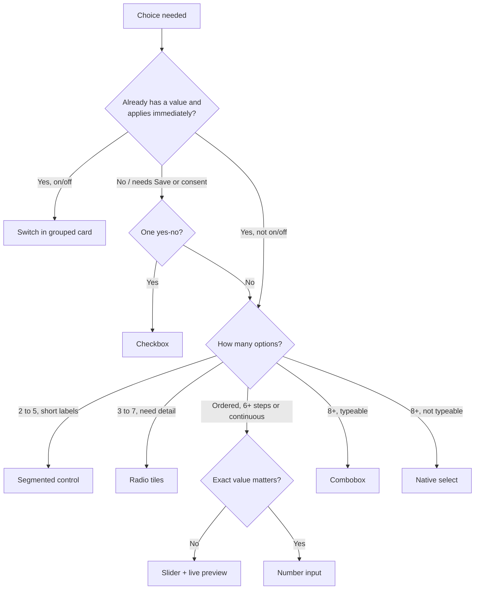

# Settings and choice controls (2026): tiles, segments, sliders, switches, short copy, sheets, usage cards

> **Retrieved:** 2026-11-05. Facts marked `[docs-verified 2026-11-05]` were read from the named primary page in
> this session (W3C WAI-ARIA APG, W3C WCAG 2.2 Understanding pages, MDN, GOV.UK Design System). `[inference]` is a
> house default no source states: a starting value you may change with a written reason. `[unverified]` was not
> fetched or could not be fetched. **No user study in this repository shows that tiles beat dropdowns or that
> shorter copy converts better.** The preference below rests on GOV.UK's own published statement about selects,
> the platform guidance quoted per control, and convention. Test it ([`ux-research`](../../ux-research/knowledge/ux-research-patterns-2026.md)
> "Testing a settings-surface redesign") before quoting it as a result.
>
> **Scope.** This is the design side: which control, how it is composed, how much text it gets. The markup,
> keyboard and screen-reader contract per control is
> [`accessibility-engineering`'s `settings-controls-markup-and-keyboard-2026-11.md`](../../accessibility-engineering/knowledge/settings-controls-markup-and-keyboard-2026-11.md).
> The component API for the primitives is in
> [`design-systems-engineering`'s reference](../../design-systems-engineering/knowledge/design-systems-reference-2026.md).
> Server-side form handling stays with [`forms-engineering`](../../forms-engineering/CLAUDE.md).
>
> **This is not the missing forms gap-fill.** The 2026-11-04 capture's forms-and-interaction run never landed
> ([`ui-pattern-standing-bar-2026-11.md`](../../ux-research/knowledge/ui-pattern-standing-bar-2026-11.md)). Nothing
> here claims to be it, nothing re-grades its rows, and no claim from that capture is reused.

## 1. Settings versus questions (decide this first)

| | **Setting** | **Question** (form field) |
|---|---|---|
| A value already exists | yes — show it | no — collecting an answer |
| Takes effect | on change (autosave) | on submit |
| Pre-selected option | **yes**, the current value | **no** — don't pre-select (see [`form-builder-2026.md`](form-builder-2026.md) single-choice row) |
| Feedback | inline "Saved" + undo where reversible | validation on submit/blur |

The rules below apply to both, but the pre-selection, autosave and switch rules differ. A control that mixes the
two (a switch inside a form that needs a Save button) is the usual defect.

## 2. The control ladder: lightest visible control that shows the choices `[docs-verified + inference]`

The principle: when the set is small and known, **show the choices instead of hiding them behind a click**.
GOV.UK says a select "should only be used as a last resort in public-facing services" because "research shows
that some users find selects very difficult to use" `[docs-verified 2026-11-05, GOV.UK Select]`. That is GOV.UK's own
research claim, not independently verified here. GOV.UK gives **no option-count threshold** for radios or selects
`[docs-verified 2026-11-05]`; the numbers below are house defaults.

| Choice shape | Control | Built from |
|---|---|---|
| On/off, applies now | **Switch** in a grouped settings card (§4) | checkbox + switch semantics |
| On/off, needs Save or is a legal/consent statement | **Checkbox**, never a switch | `<input type=checkbox>` |
| 2–5 short mutually exclusive options (mode, view, density, text-size stops) | **Segmented control** (§3) `[inference: cap 5]` | native radio group |
| 3–7 options that need a description, price, icon or badge | **Radio tiles** (choice cards) (§3) `[inference]` | native radio group, label wraps the tile |
| Money or quantity presets plus "something else" | **Amount tiles** + "Other" that reveals a number field | radios + `inputmode="decimal"` text input |
| Several of a small set | **Checkbox tiles / chips** | native checkboxes |
| Continuous or ≥6 ordered steps, exact value unimportant (text size, volume, density) | **Slider with live preview** (§5) | native `input type=range` |
| Exact number (quantity, amount) | Text input, `inputmode="numeric"`, optional stepper buttons | per [`form-builder-2026.md`](form-builder-2026.md) |
| 8+ options, known list people can type (country, timezone) | **Combobox/autocomplete**; a native `<select>` is acceptable where the mobile picker helps `[inference]` | `<select>` or combobox |
| Large multi-select | Searchable list with checkboxes | listbox/combobox |



**Do not "fix" a `<select>` by restyling it as a custom listbox.** Replace it with a visible control (above) or a
combobox, or leave the native one. A custom div-based dropdown is the scenario in
[`accessibility-engineering/scenarios`](../../accessibility-engineering/scenarios/2026-06-08-clean-scan-was-not-conformance.md).

## 3. Segmented controls, radio tiles, amount tiles

1. **They are radio groups.** One `fieldset` + `legend`, one native radio per option, arrow keys move and select,
   one tab stop `[docs-verified 2026-11-05, APG Radio Group]`. A segmented control that switches **panels** of
   content is tabs, not a segmented control: use the tabs pattern `[unverified this session]`.
2. **Labels ≤ 2 words / ~12 characters** per segment `[inference]`. A label that wraps is a tile, not a segment.
3. **Equal width, one row.** If segments don't fit at 320 px (see [`adaptive-layout`](../skills/adaptive-layout/SKILL.md)),
   switch to a stacked tile list. Don't scroll a segmented control sideways.
4. **Selected state is more than color:** fill + weight or a check/outline (house rule [`color-not-the-only-signifier`](../best-practices/color-not-the-only-signifier.md)).
5. **Hit area is the whole segment or tile**, at least 24×24 CSS px (WCAG 2.5.8, [`a11y-visible-focus-and-target-size`](../best-practices/a11y-visible-focus-and-target-size.md)); aim for 44 px high on touch `[inference]`.
6. **Tile anatomy:** title (the label) → one-line caption → optional trailing value (price, badge). No links or
   buttons *inside* a tile; the tile is the label of one input `[inference]`.
7. **Amount tiles:** 3–5 presets, the most common pre-highlighted only when it is a *setting* (§1), always an
   "Other" tile revealing one numeric field. The currency is in the group label, not only a `$` glyph (prefixes
   are not read out; see the Currency row in [`form-builder-2026.md`](form-builder-2026.md)).
8. **Single-select reveals:** reveal only *questions*, keep them simple, never under inline radios
   `[docs-verified 2026-11-05, GOV.UK Radios]`; GOV.UK also notes revealed content is not always announced.

## 4. Switches in grouped cards

1. **One card per topic.** Card heading (an `h2`) + rows. Each row: short label, optional one-line caption, switch
   on the right. The whole row is the click target through the label `[inference]`. This is the
   [`card-tile-ui`](../skills/card-tile-ui/SKILL.md) tile with rows inside it.
2. **Fixed label.** The label does not change with state ("Email alerts", not "Enable email alerts" / "Disable
   email alerts") — APG calls this critical `[docs-verified 2026-11-05, APG Switch]`.
3. **A switch means "now".** It applies on change, shows "Saved" (or an error and a rollback), and is reversible.
   Anything that needs a Save button, a confirmation, or is a legal agreement is a checkbox `[inference]`.
4. **State text for non-sighted and low-vision users:** the switch shows On/Off *text or a glyph*, not only a
   thumb position and color.
5. **Order by frequency, then risk.** Put destructive or irreversible settings in their own card, not as a
   switch in a list of harmless ones `[inference]`.
6. **Don't depend on the native `switch` attribute yet.** MDN flags `<input type=checkbox switch>` as experimental
   with limited support `[docs-verified 2026-11-05, MDN]`. Style a checkbox yourself.

## 5. Sliders with live preview (text size, density, volume)

1. **Native `input type=range`**, implicit role `slider` `[docs-verified 2026-11-05, MDN]`. Use it only when the
   exact value is unimportant; MDN: "this kind of widget is imprecise" `[docs-verified]`. Otherwise use a number
   input (§2).
2. **≤5 named stops → prefer the segmented control** with a preview; **≥6 steps or continuous → slider** `[inference]`.
   The two share one preview component.
3. **Live preview, applied on `input`, committed on `change`** `[inference]`. The preview is a real sample (the
   paragraph, the card), not a label. Tie to the existing game-UI settings row in
   [`game-ui-lessons-for-the-web-2026.md`](game-ui-lessons-for-the-web-2026.md) §3 ("Settings with live preview").
4. **Show the value** next to the control in an `<output>` with units, and set `aria-valuetext` to a human string
   ("Large, 18 px"), because APG says to use it when the number "isn't user-friendly"
   `[docs-verified 2026-11-05, APG Slider]`.
5. **Label the endpoints** ("Smaller" / "Larger") and give the stops names where they exist.
6. **A reset to default** sits beside every slider that has a default `[inference]`.
7. **Dragging needs a non-drag path.** WCAG 2.5.7 (Level AA) requires a single-pointer alternative to dragging;
   its Understanding page treats a range slider as in scope and names click/tap on the track as one alternative
   `[docs-verified 2026-11-05]`. It does **not** say whether a *native* slider falls under the user-agent exception
   `[docs-verified: silent]`. Rule: add −/+ step buttons on any text-size or other settings slider `[inference]`.
8. **Text size is not zoom.** The preview scales `rem`-based type; it never replaces browser zoom or breaks reflow
   at 200 % (WCAG 1.4.4 / 1.4.10 `[unverified this session]` — verify with the device matrix).

## 6. Short copy: label + caption + "more info"

The goal is scanning. Make the control carry the meaning and keep words for the cases that need them.

| Layer | Budget `[inference]` | Always visible? |
|---|---|---|
| Page title | ≤ 4 words | yes |
| Page lede | none, or one sentence | yes |
| Group heading | ≤ 3 words | yes |
| Control label | ≤ 4 words / ~28 characters | yes |
| Caption | ≤ 1 line (~80 characters), plain verb | yes |
| "More info" | ≤ 2 sentences + one "Learn more" link | on demand (toggletip) |

1. **A caption only restates what the label can't carry:** the consequence ("Pauses new bookings"), a unit, a
   limit. If it repeats the label, delete it.
2. **Essential information is never only in the "more info".** Cost, irreversibility, a limit, an error and
   anything needed to decide stay visible. Inclusive Components calls tooltips "a last resort, where space really
   is at a premium" and the `title` attribute "not keyboard accessible" `[docs-verified 2026-11-05, secondary
   source, single author]`.
3. **Toggletip, not tooltip, for "more info".** A real `<button>` labelled "More about <label>" reveals the
   message into a `role="status"` region. Tooltips fire on focus, which on touch happens at the moment of press
   `[docs-verified 2026-11-05, Inclusive Components]`. Tooltips remain right for naming an icon-only control or
   expanding an abbreviation. Primary navigation still needs a **visible** label
   ([`ui-pattern-standing-bar-2026-11.md`](../../ux-research/knowledge/ui-pattern-standing-bar-2026-11.md) solid rule).
4. **Hover/focus content must satisfy WCAG 1.4.13 (AA):** dismissible without moving pointer or focus, hoverable,
   persistent until dismissed `[docs-verified 2026-11-05]`. APG's own tooltip page is marked work in progress with
   no task-force consensus `[docs-verified 2026-11-05]`, so don't cite it as settled.
5. **Cut by moving, not deleting.** Long explanation moves to a docs page behind "Learn more". Removing words that
   carried a decision has cost conversion before; read
   [`forms-engineering` scenario 2026-08-17](../../forms-engineering/scenarios/2026-08-17-we-removed-fields-and-conversion-fell.md)
   (denominator, then claim) before reporting that shorter copy "worked".

**Before → after** (illustrative, not measured):

```text
Before: [Dropdown: Notification frequency ▾]   "Choose how often you would like to receive
        email notifications from us about activity in your account. You can change this at any time."
After:  Email digest    [ Instant | Daily | Weekly ]            (segmented control)
        Summary of account activity.                           ⓘ  (toggletip: "Instant sends each event…")
```

## 7. Bottom sheets and overlays (connector authorize, multi-account)

A bottom sheet is a **modal dialog** that sits at the bottom on narrow screens and as a centered dialog or side
panel on wide ones. It adds no ARIA pattern of its own `[inference]`.

1. **Build on the modal-dialog pattern:** `role="dialog"`, `aria-modal="true"`, a visible title as the name, focus
   moves in on open, Tab is contained, Esc closes, focus returns to the opener `[docs-verified 2026-11-05, APG
   Dialog (Modal)]`. This repo already prefers native `<dialog>.showModal()` over a bespoke modal
   ([`reach-for-semantic-html-before-aria`](../best-practices/reach-for-semantic-html-before-aria.md); APG's page
   does not mention the native element `[docs-verified]`).
2. **Drag handle and swipe-down are enhancements.** A visible Close button and Esc always exist (WCAG 2.5.7).
3. **One sheet deep.** A sheet never opens a sheet `[inference]`. "Add another account" replaces the content.
4. **Sizing:** `max-height` in dynamic viewport units with the safe-area insets from
   [`adaptive-layout`](../skills/adaptive-layout/SKILL.md); content scrolls inside the sheet, the title and primary
   action stay visible `[inference]`.
5. **State in the URL when not secret** (which sheet, which provider), so Back closes it and a reload resumes.
   Tokens, codes and emails never go in the query string
   ([`portal-and-agent-accessibility-2026-11.md`](../../accessibility-engineering/knowledge/portal-and-agent-accessibility-2026-11.md), provisional row).

**Connector authorize flow** `[inference — design guidance, not a studied flow]`:

| Step | Surface | Content |
|---|---|---|
| 1 | Settings card row | Provider name, status chip (icon + text), one action: "Connect" |
| 2 | Sheet opens | Title "Connect <Provider>"; **what it can access** as a short list in plain words (one line per scope); the account list as radio tiles with "Add another account" last |
| 3 | Primary action | "Continue to <Provider>" leaves for the provider's own consent page. **Never collect the provider's credentials in your UI.** |
| 4 | Return | Back on the row: "Connected as <account>"; focus to the row; "Saved" announced once |
| 5 | Manage | Each connected account is a row: identifier, status, "Make default" (radio), "Disconnect" |
| 6 | Failure | Status "Needs attention" + "Reconnect" (not color alone) |

Disconnect confirms and **names what is lost** (provisional row in the same portal file). The authorize redirect,
token storage, scope handling and callback validation are an authentication surface: **binding verdict →
`ravenclaude-core` `security-reviewer`** (zero exceptions). This file specifies the visible surface only.

## 8. Usage and status cards with progress

1. **Pick the element by meaning.** A quantity inside a known range (storage used, seats, quota) is a
   **`<meter>`**: "a scalar value within a known range", with `low`/`high`/`optimum` `[docs-verified 2026-11-05,
   MDN meter]`. Completion of a task or load is a `<progress>` `[unverified this session — confirm in the HTML spec]`.
2. **The number is always written.** "6.2 of 10 GB used (62 %)" is visible text; the bar is redundant. Threshold
   color never stands alone: add a word or icon ("Almost full") ([`color-not-the-only-signifier`](../best-practices/color-not-the-only-signifier.md)).
3. **Anatomy:** metric title → large figure → bar → one caption (reset date, plan) → **one** action, shown when it
   matters ("Add storage"). One CTA per card, one dominant per screen (house opinion #8).
4. **Reserve the size while loading** with a skeleton of the real card (solid rule in the standing bar).
5. **Animate the fill only under a `prefers-reduced-motion` gate** ([`a11y-respect-motion-and-forced-colors-preferences`](../best-practices/a11y-respect-motion-and-forced-colors-preferences.md)).
6. **Cards are tiles** ([`card-tile-ui`](../skills/card-tile-ui/SKILL.md)): same radius, border and shadow tokens; the
   status accent stays within the one-accent budget, so use neutral fills with an icon for state.

## 9. Page composition

- One column of cards, content width ≤ ~720 px `[inference]`; the navigation rail rules are unchanged.
- **Autosave for switches, segments and sliders; an explicit Save for multi-field text.** Don't mix both in one
  card `[inference]`. Show "Saved" as a polite status, once per commit, not per drag tick.
- Add search once a page exceeds about 15 settings `[inference]`.
- Real copy in the mock (house opinion #6). Check the longest label and the longest account email at 320 px.

## 10. Anti-patterns agents can detect

| Signature | Fix |
|---|---|
| `<select>` with ≤ 5 options in a settings or checkout flow | Segmented control or radio tiles (§2) |
| A paragraph above a control that restates its label | Delete it; caption only (§6) |
| Caption longer than two lines, or "more info" needed to decide | Move decisive text out of the tooltip (§6.2) |
| Info only in `title=` or hover-only | Toggletip button (§6.3) |
| Slider with no visible value, no `aria-valuetext`, or no preview | §5.3–5.4 |
| Switch label flips with state; switch inside a form with a Save button | §4.2–4.3 |
| Segmented control built from `div`s or `role="tablist"` for a non-panel choice | Native radios (§3.1) |
| Tile is a clickable `div` | Label + radio/checkbox |
| Sheet with only a drag handle to close | Close button + Esc (§7.2) |
| Connect flow that asks for the provider's password in your UI | Redirect to the provider; security review (§7) |
| Usage bar with no number, or color-only threshold | §8.2 |

## 11. What this file does not establish

- That any of these choices raises completion or satisfaction. It is a hypothesis to test.
- Material 3's segmented-button segment limits: the page is script-rendered and returned no text
  `[unverified — fetch failed 2026-11-05]`. The "cap 5" above is a house default.
- Apple HIG or Android controls guidance (touch-target sizes beyond WCAG's 24 px, sheet detents): `[unverified]`.
- The Popover API and `popover` for toggletips: provisional in the standing bar; ship a support check.
- Any specific screen-reader announcement. Test it ([`test-assistive-tech`](../../accessibility-engineering/skills/test-assistive-tech/SKILL.md)).

## Sources (retrieved 2026-11-05)

- W3C APG: [Switch](https://www.w3.org/WAI/ARIA/apg/patterns/switch/), [Slider](https://www.w3.org/WAI/ARIA/apg/patterns/slider/), [Radio Group](https://www.w3.org/WAI/ARIA/apg/patterns/radio/), [Dialog (Modal)](https://www.w3.org/WAI/ARIA/apg/patterns/dialog-modal/), [Tooltip](https://www.w3.org/WAI/ARIA/apg/patterns/tooltip/)
- W3C WCAG 2.2 Understanding: [2.5.7 Dragging Movements](https://www.w3.org/WAI/WCAG22/Understanding/dragging-movements.html), [1.4.13 Content on Hover or Focus](https://www.w3.org/WAI/WCAG22/Understanding/content-on-hover-or-focus.html)
- MDN: [`input type=range`](https://developer.mozilla.org/en-US/docs/Web/HTML/Reference/Elements/input/range), [`input type=checkbox` (switch attribute)](https://developer.mozilla.org/en-US/docs/Web/HTML/Reference/Elements/input/checkbox), [`meter`](https://developer.mozilla.org/en-US/docs/Web/HTML/Reference/Elements/meter)
- GOV.UK Design System: [Select](https://design-system.service.gov.uk/components/select/), [Radios](https://design-system.service.gov.uk/components/radios/)
- Heydon Pickering, [Inclusive Components: Tooltips & Toggletips](https://inclusive-components.design/tooltips-toggletips/)
